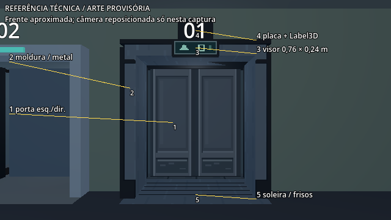
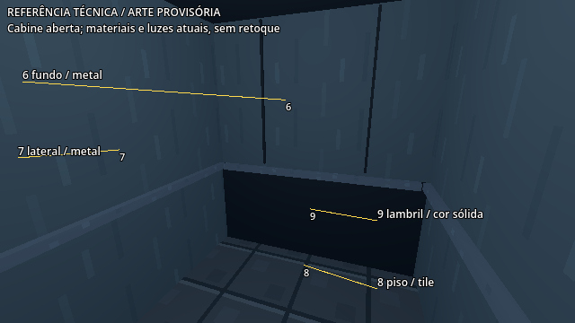
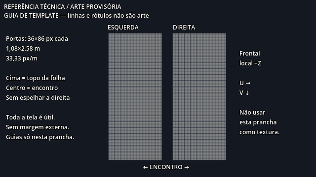
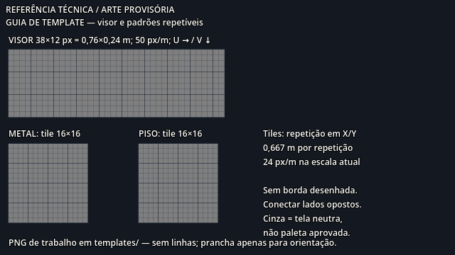

# Referências técnicas — arte atual provisória

Capturas reais do `RoomViewport`, geradas com Godot **4.7.2**, driver OpenGL
Compatibility, resolução nativa **640×360**, materiais e iluminação existentes.
A seleção desse driver valeu somente para o comando de captura; não modificou
`project.godot`. Os rótulos foram sobrepostos pelo utilitário apenas durante a
captura. Não houve geração de arte definitiva ou retoque dos renders.

## Vistas do ambiente

| Arquivo | Vista / uso |
| --- | --- |
| `ref_reception_closed_640x360.png` | Posição inicial real do posto, yaw local −55°, portas fechadas. Avaliar perspectiva, tamanho e oclusão pelo balcão. |
| `ref_reception_open_640x360.png` | Mesmo ponto de vista, Elevador 1 aberto; comparar profundidade e visibilidade da cabine. |
| `ref_surface_map_front_640x360.png` | Câmera de captura na coordenada local do elevador `(0,1.6,3.2)`, olhando para `(0,1.6,-0.6)`. Identifica superfícies frontais. |
| `ref_surface_map_cabin_640x360.png` | Câmera de captura em `(0.55,1.8,-0.85)`, olhando para `(-0.25,1.15,-3.15)`, com portas abertas. Mostra paredes, lambril, corrimãos e piso. |

As vistas aproximadas reposicionam a câmera **só na instância temporária em
memória** e preservam FOV 70°. Não indicam mudanças na cena nem escala de UV
inferível diretamente dos pixels da fotografia: há perspectiva.

| Número no mapa | Superfície | ID no inventário |
| --- | --- | --- |
| 1 | Duas frentes das portas | E01-01L / E01-01R |
| 2 | Moldura, metal repetível ou cor sólida | E01-03 |
| 3 | Frente do visor | E01-02 |
| 4 | Placa e Label3D independente | E01-08 |
| 5 | Soleira metálica e sulcos escuros | E01-03 / E01-10 |
| 6 | Parede do fundo | E01-03; E01-05 somente após preparo de UV |
| 7 | Parede lateral | E01-03; E01-06 somente após preparo de UV |
| 8 | Piso | E01-04; E01-07 é alternativa futura |
| 9 | Lambril sólido | E01-09 |

## Pranchas para desenho

- `guide_doors_640x360.png`: duas telas 36×86 ampliadas em **3×**, grade e
  orientação frontal. A distância entre as telas na prancha é apenas gráfica,
  não representa a separação de 0,01 m das frentes no modelo.
- `guide_display_tiles_640x360.png`: visor 38×12 ampliado em **8×** e tiles
  16×16 em **7×**, com áreas úteis, grade e densidades indicadas.

Os templates de desenho estão em `../templates/`, sem grade ou rótulos.
As pranchas são orientação técnica, **não entregas artísticas**.

## Medições e limites

`measurements.json` registra versão da engine, dimensões dos meshes, posições,
normais e UVs reais, além das caixas projetadas na câmera do posto ao limite
direito. As posições dos vértices são locais ao mesh. UVs de QuadMesh ocupam
0–1; BoxMesh usa atlas automático 3×2, substituído hoje pelo triplanar.

A porta esquerda projeta aproximadamente **25,75×73,47 px** e o visor,
**20,55×9,27 px**. São caixas geométricas, sem descontar oclusão nem medir pixels
efetivamente visíveis. Use as capturas para avaliar oclusão e contraste.

O canto superior da cabine e a luminária não estão enquadrados no mapa interno;
se precisarem de arte, pedir uma referência específica antes de produzir.
Os materiais e o ambiente tornam as imagens escuras por definição da cena atual;
isso não obriga a equipe de arte a reproduzir essa paleta. As capturas não
substituem avaliação de luz, movimento e legibilidade dentro da Godot.
